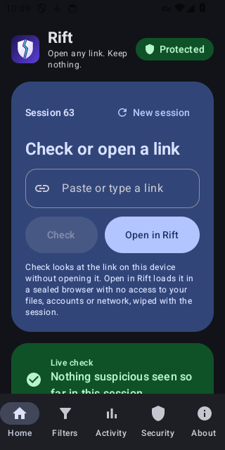
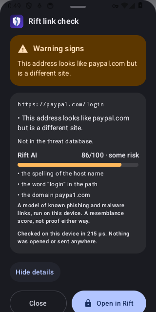
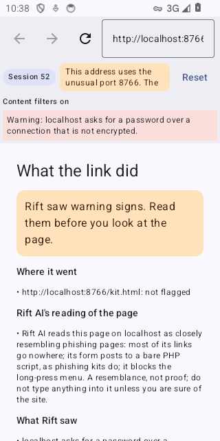
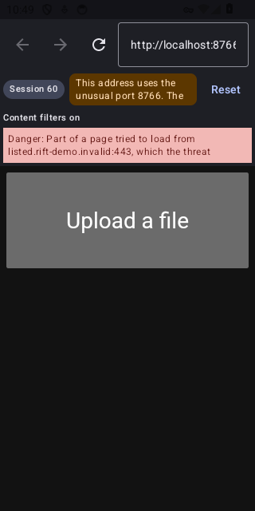
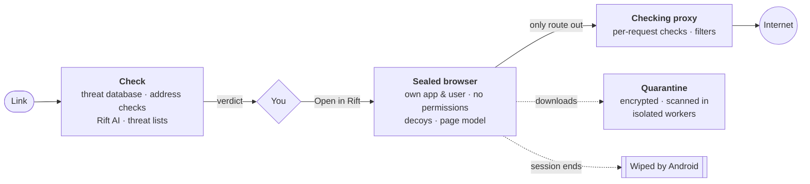

<div align="center">


# Rift

**Open any link without letting it near your phone.**

Rift checks links before they open, opens them in a sealed, disposable browser,<br>
and quarantines and scans files in isolated workers, all on the device.

[](https://github.com/Order52/Simulation-Rift/releases/latest)
[](https://github.com/Order52/Simulation-Rift/actions/workflows/ci.yml)


[](#license)

[**Download**](https://github.com/Order52/Simulation-Rift/releases/latest) ·
[Features](#features) ·
[How it works](#how-it-works) ·
[Install](#install) ·
[Build](#build-from-source) ·
[Documentation](#documentation)

</div>

<p align="center">
  
  
  
  
</p>
<p align="center"><sub>Home · Check · Check the live page · The sealed browser (Android 14 emulator, dark theme)</sub></p>

> [!WARNING]
> **Rift is in development and has not been audited.** It is tested on Android emulators (API 33–36) and one phone (Android 12). Every security claim names its boundary and the test that shows it; see [STATUS.md](STATUS.md) for what works today and its limits.

## Features

### 🔍 Check a link before you open it

Paste a link, or share it to Rift from any app, and a sheet comes up over that app with a verdict, the reasons behind it, and **Open in Rift**. The check runs on the phone and sends nothing anywhere.

| Verdict | Meaning |
|---|---|
| **Known malicious** | In Rift's signed threat database |
| **Listed as dangerous** | On a community threat list (HaGeZi, Phishing Army) |
| **Looks dangerous** / **Warning signs** | Address checks or Rift AI found problems |
| **Rift won't open this** | Blocked by Rift's policy, with the reason |
| **No known threats found** | Nothing found. Rift never calls a link "safe" |

The check combines:
- **Rift's signed threat database**, verified with TUF before it is loaded.
- **Address checks**: lookalikes of well-known sites, link shorteners, and links that hide their real host.
- **Rift AI**, a model of phishing and malware addresses trained on public feeds ([accuracy](docs/reports/rift-ai.md)).
- **Community threat lists**: HaGeZi, Phishing Army, uBlock Origin badware and StevenBlack. They update themselves once downloaded.

On 300 current phishing links, Check called 97.7% dangerous. URLCheck's hosts check flagged none of them ([comparison and caveats](docs/reports/check-accuracy.md)). An optional history of checked links is kept encrypted on the phone.

### 🌐 Check the live page

**Check the live page** loads the link out of sight for 10 seconds in a new sealed session. It reports:
- where the link went;
- what the page asked for;
- the trackers and sites it reached;
- Rift AI's reading of the page.

Plain Check never contacts the site, so the sender can't tell the link was looked at.

### 🧠 Rift AI reads the page

A second model looks at what an opened page is made of. It weighs:
- password forms that send to another site;
- links that go nowhere;
- a brand name that doesn't match the site;
- urgent "your account is locked" text;
- hidden frames and obfuscated scripts.

It warns **before you type anything**. On sites it had never seen, it flagged 54% of phishing pages, with 0.23% false alarms ([report](docs/reports/page-model.md)).

### 🛡️ A sealed, disposable browser

Links open in a separate app with its own Linux user, no permissions, and no network except Rift's checking proxy. Android wipes everything it held when the session ends. While a page is open, the **live watch** lists what it tries:
- a listed address;
- your local network;
- a connection around the proxy;
- a download;
- every device feature it asks for.

If the phone's Android System WebView is missing a fix for a Chromium bug that attackers are actively using ([CISA KEV](https://www.cisa.gov/known-exploited-vulnerabilities-catalog)), Rift refuses to open pages and says which update fixes it.

### 👣 Trackers, explained

- **In links:** Check names each tracking parameter (`fbclid`, `gclid`, `utm_…` and others), says who added it and what it tells them, and removes them with one tap.
- **On pages:** the live watch names each tracking service a page reaches (such as Google Analytics, the Meta pixel or Hotjar session replay), explains what it records, and says how to stop it.

### 🎭 Decoys

A page that asks for the camera, microphone, screen, location, files, notifications, clipboard, motion sensors or battery is told yes, and gets something made up: a live video of a dim room, near-silence, a position near a city centre, a generated photo, an empty clipboard. A phishing or spying page carries on as if it had won, and you see what it was after. Nothing real is given: the browser holds none of those permissions.

### 📁 Files in quarantine

Downloads and files shared to Rift go into an encrypted quarantine for the session and are scanned in isolated workers. Images and PDFs are drawn by a worker with no files and no network. Text is shown as plain text, never run. A file whose contents don't match its name is flagged, including an Android app under another name.

### 🧹 Filters

Rift blocks ads and trackers and hides cookie banners, pop-ups and sign-in prompts in its browser, using lists the community already keeps (EasyList, uBlock Origin, Fanboy, AdGuard). You choose which lists to download, switch each one on or off, and can add rules of your own.

### 🔒 Extra isolation (optional)

With [Shizuku](https://shizuku.rikka.app) or root, one switch hardens the browser further:
- Android ignores the browser's clipboard, so a page can't swap what you copy.
- Android itself wipes the browser at each reset.
- With root, a firewall keeps the browser to Rift's proxy.

Each change is checked after it's made and undone when you switch it off.

### 🌙 Dark theme

Rift and its sealed browser follow the phone's dark theme, or stay light or dark (**About → Appearance**). In dark, pages without a dark style of their own are darkened too.

### 🕊️ Keeps nothing

Nothing is kept after a session, and nothing asks for a password. The home screen shows only weekly counts: threats blocked, dangerous files, warnings and links checked.

## How it works



- **Two apps, two users.** The controller (`org.simulationrift.app`) holds the checks, the proxy and the UI, and no WebView. The browser (`org.simulationrift.browser`) holds the WebView, but no permissions and no Rift data. They talk only through signature-guarded Binder interfaces.
- **A network lock.** A VPN that applies only to the browser drops all of its traffic, so its only way out is the proxy on the phone.
- **Isolated workers.** File parsers run in `isolatedProcess` services that receive only file descriptors. Their output is treated as untrusted.
- **A Rust core.** The trusted logic (URL handling, policy, threat data, the proxy, downloads, sessions) is Rust, with `unsafe` forbidden.

The full design, threat model and 14 invariants are in [docs/architecture.md](docs/architecture.md).

## Install

1. Download **`rift-<version>.apk`** from the [latest release](https://github.com/Order52/Simulation-Rift/releases/latest).
2. Check its SHA-256 against the one in the release notes.
3. Open it on the phone (Android 11 or newer, arm64) and allow the install.
4. On first launch, Rift installs the sealed browser it carries. Android asks you to allow that. Later updates of Rift update the browser by themselves.

| File | Needed? |
|---|---|
| `rift-<version>.apk` | **Yes**: the app |
| `rift-browser-<version>.apk` | **Optional**: the sealed browser on its own. Download it only if your phone blocks Rift from installing it (some Huawei phones do). Install it by hand, then open Rift. |

Updates keep your settings. Every release is signed with the same certificate, SHA-256 `8b5952712e7ceda065f558e1de902e12b97027a3244181f8d0330fbc6a47ee8b`.

### Updates

**Rift updates itself.** When you open it, Rift asks GitHub for its latest release and, if there is a newer one, offers it in a dialog: one tap on **Update** installs it. Once a day it also checks by itself, and after the first update (which Android asks you to confirm) it installs new releases on its own while you are not using it (Android 12 and newer). Every update is checked against the SHA-256 published with it and must be signed with Rift's own certificate. Under **About → Updates** you can switch off **Check when Rift opens** or **Update Rift by itself**, and **Check for updates** checks right away.

Or use [Obtainium](https://obtainium.imranr.dev): with Obtainium installed, open **[Add Rift to Obtainium](https://apps.obtainium.imranr.dev/redirect?r=obtainium://app/%7B%22id%22%3A%22org.simulationrift.app%22%2C%22url%22%3A%22https%3A%2F%2Fgithub.com%2FOrder52%2FSimulation-Rift%22%2C%22author%22%3A%22Order52%22%2C%22name%22%3A%22Rift%22%2C%22preferredApkIndex%22%3A0%2C%22additionalSettings%22%3A%22%7B%5C%22apkFilterRegEx%5C%22%3A%5C%22%5Erift-%5C%5C%5C%5Cd%5C%22%2C%5C%22includePrereleases%5C%22%3Afalse%7D%22%7D)** on the phone. To add it by hand instead, add `https://github.com/Order52/Simulation-Rift`, with `^rift-\d` under **Filter APKs by regular expression** (so it takes the app, not the optional browser file).

### What updates itself

| What | How often | How |
|---|---|---|
| Threat lists, filter lists, link-cleaning rules | Daily | In the app |
| Android System WebView | As Google ships it | Play Store (Rift refuses one missing an exploited fix) |
| The app and its browser | Weekly release, when anything changed | Rift installs it itself (or Obtainium does) |
| Exploited-WebView list | Weekly | From CISA's catalogue, merged when CI passes |
| Rift AI (address model) | Monthly | Retrained on current feeds plus its memory of the last 24 months' phishing pages, merged if it passes its accuracy gate and CI |
| Rust, Gradle and Actions dependencies | Weekly | Dependabot, versions at least 7 days old, merged when CI passes |
| Rust compiler, NDK, cargo-ndk, OSV-Scanner | Monthly | Moved to the latest release, merged when CI passes |

## Build from source

**Requirements:** Rust (pinned in `rust-toolchain.toml`), the Android SDK and NDK, `cargo-ndk`, and JDK 21.

```sh
sh android/build.sh             # Rust libraries, bindings, debug APKs and unit tests
sh android/run-tests.sh <dir>   # full device suite on an attached emulator; evidence goes to <dir>
sh android/release.sh           # signed arm64 release APK (key kept outside the repo)

cargo test --workspace --locked
cargo clippy --workspace --all-targets --locked -- -D warnings
```

[CLAUDE.md](CLAUDE.md) lists every command, including how to run a single test.

## What Rift is not

- **Not an antivirus, a VM or a malware lab.** It never runs downloaded programs.
- **Not a cloud service.** It sends no content anywhere.
- **Not a guarantee.** It doesn't claim perfect isolation, or that any link is safe. What isn't covered is listed in [architecture §24](docs/architecture.md).

## Documentation

| Document | What it covers |
|---|---|
| [User guide](docs/user-guide.md) | Installing Rift and using every screen |
| [Developing Rift](docs/development.md) | Setup, code map, building, testing, CI, rules for changes |
| [Maintaining Rift](docs/maintenance.md) | Releases, keys, Rift AI's retraining, the automated workflows |
| [STATUS.md](STATUS.md) | What works now, what's left, the known limits |
| [docs/architecture.md](docs/architecture.md) | Design, threat model, invariants, acceptance tests, residual risks |
| [docs/reports/](docs/reports/) | Evidence for every claim: Verified, Unverified, Could be improved |
| [Latest release report](docs/reports/release-3-1.md) | Changes and test results for 0.11 |
| [All documentation](docs/README.md) | Every guide and report |
| [SECURITY.md](SECURITY.md) | How to report a vulnerability |
| [TODO.md](TODO.md) | Planned work, including the Linux version |

## Repository layout

| Path | Contents |
|---|---|
| [`crates/`](crates/) | Rust workspace: core logic, workers, FFI, signed updates |
| [`android/`](android/) | Android app: controller, sealed browser, bridge, test app |
| [`models/`](models/) | Rift AI's models (address and page) with their data notices |
| [`tools/`](tools/) | Signed-pack builder and `rift-train`, Rift AI's trainer |
| [`fuzz/`](fuzz/) | Fuzz targets for the parsers of untrusted input |
| [`linux/`](linux/) | Linux app (on hold) |
| [`poc/`](poc/) | Phase 0 feasibility harnesses (not product code) |
| [`docs/`](docs/) | Architecture, reports, evidence and screenshots |

## Security

Please report vulnerabilities privately through [GitHub Security Advisories](https://github.com/Order52/Simulation-Rift/security/advisories/new). See [SECURITY.md](SECURITY.md).

## License

Dual-licensed under [MIT](LICENSE-MIT) or [Apache-2.0](LICENSE-APACHE), at your option. Rift AI's page model was trained on data under CC BY 4.0; see [`models/page-model-notice.txt`](models/page-model-notice.txt).
